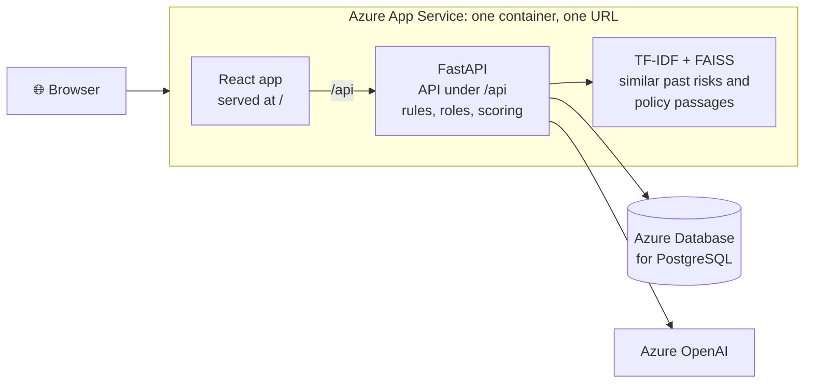

# RiskPilot: AI-Powered Project Risk & Issue Triage and Mitigation

A governed risk and issue register for banking technology programmes. It scores records with a fixed formula, uses Azure OpenAI to extract risks from emails and draft structured mitigation plans grounded in past banking risks and the bank's own policies, and requires review and approval before a record is closed.

**Domain:** Financial Risk Management (banking technology programmes)
**Users:** Project Manager, Risk/Issue Owner, Programme Lead
**Tech Stack:** React (Vite), FastAPI, PostgreSQL, Azure OpenAI, TF-IDF + FAISS, Docker, Azure

## Features
- Register with standard fields, owner, due date and status
- Score = Probability x Impact (Low 1-5, Medium 6-12, High 13-19, Critical 20-25)
- Draft with AI: structured risk assessment with cause, potential impact, warning indicators, and preventive, corrective and contingency actions
- Import from text: AI finds risks and issues in emails or meeting notes
- RAG: AI uses similar past banking risks and uploaded bank policy PDFs as context, citing the policy and page
- Citation guard: unsupported policy, page and regulation citations are removed before the user sees them
- Scope check: out-of-scope text gets a clear fallback message instead of an AI draft
- Review workflow: Open -> In Progress -> Pending Review -> Closed
- Role-based permissions and full audit log
- Dashboard with filters and a 5 x 5 risk matrix

## Architecture

The browser loads the React app and calls the API on the same URL. FastAPI applies the rules, stores data in PostgreSQL, retrieves similar past risks and policy passages with TF-IDF + FAISS, and asks Azure OpenAI for drafts. Details: [docs/architecture.md](docs/architecture.md).

## Setup
Create `.env` in the project root (see `.env.example`):
```
AZURE_OPENAI_ENDPOINT=https://your-resource.openai.azure.com/
AZURE_OPENAI_API_KEY=your_key_here
AZURE_OPENAI_DEPLOYMENT=your_deployment_name
AZURE_OPENAI_API_VERSION=2024-10-21
```
To use PostgreSQL, set `DATABASE_URL` before starting the backend. Without it, a local SQLite file is used.

## Run with Docker (whole app, one URL)
One container serves both the website and the API, exactly as on Azure:
```
docker build -t riskpilot .
docker run -d --name riskpilot --env-file .env -p 8000:8000 riskpilot
```
- Website: http://127.0.0.1:8000
- API: http://127.0.0.1:8000/api (for example `/api/health`, `/api/items`)
- API docs: http://127.0.0.1:8000/docs

## Run for Development
Backend (API on http://127.0.0.1:8000, also under `/api`):
```
venv\Scripts\activate
cd backend
pip install -r requirements.txt
uvicorn app.main:app --reload
```
Frontend with hot reload (http://localhost:5173), in a second terminal:
```
cd frontend
npm install
npm run dev
```
The website calls `/api` on its own origin; the Vite dev server forwards `/api` to the backend, so no API URL needs to be set. To point the website at a different backend, set `VITE_API_URL` (for example `VITE_API_URL=https://my-api.example.com/api`).

If you build the frontend locally (`npm run build`), the backend also serves it at http://127.0.0.1:8000.

## Run the Tests
```
cd backend
pip install -r requirements-dev.txt
pytest
```
56 tests run with the AI mocked, so Azure is never called in tests. Load test and test details: `docs/testing.md`.

## AI Evaluation
The AI was evaluated on 15 test cases against Azure OpenAI, with an AI-assisted first pass and a final human review.

| Check | Result |
|-------|--------|
| Reviewer accepted (all cases) | 14/15 (93%) |
| In-scope drafts accepted | 9/10 (90%) |
| Out-of-scope cases with correct fallback | 3/3 (100%) |
| Adversarial cases handled | 2/2 (100%) |
| Unsupported citations in final drafts | 0 |

Full results, before/after comparison and how to re-run: `docs/evaluation.md`. The sample policy used is `data/sample_policies/Vendor_Management_Policy.pdf` (synthetic, not a real bank policy).

## Deployment (Azure)
RiskPilot is live on **Azure App Service** as one container: FastAPI serves the React app at `/` and the API under `/api`, on one URL. It uses **Azure Database for PostgreSQL** for records, history and policies, and **Azure OpenAI** for the AI features. **CD (GitHub Actions)** publishes the image to GHCR and deploys it to the Web App on every push to `master`. Azure Static Web Apps is not used, because it is blocked by the sandbox policy. A screenshot of the live app is in `docs/screenshots/06_live_azure.png`.

## API Routes
All routes are under `/api` (they also answer at the root path, for tools and tests). Routes that change data need an `X-Role` header (`Project Manager`, `Risk Owner` or `Programme Lead`). Interactive docs: `/docs`.

| Method | Path | Purpose |
|--------|------|---------|
| GET | `/api/health` | Health check: returns `{"status": "ok"}` |
| GET | `/api/items` | List records, with optional filters (status, priority, owner, category, overdue) |
| POST | `/api/items` | Create a record; score and priority are calculated (Project Manager only) |
| GET | `/api/items/{item_id}` | Get one record |
| PUT | `/api/items/{item_id}` | Edit a record; score is recalculated (Project Manager or Risk Owner, not when Closed) |
| PATCH | `/api/items/{item_id}/status` | Change status through the review workflow, with an optional note |
| GET | `/api/items/{item_id}/audit` | Full audit trail of a record: who changed what and when |
| GET | `/api/dashboard/summary` | Totals for the dashboard: open, overdue, high priority, by status and by priority |
| POST | `/api/suggest` | Draft with AI: scope check, then a structured draft grounded in similar risks and policies, with citations checked |
| POST | `/api/extract` | Import from text: AI extracts risks and issues from an email or meeting notes as drafts |
| GET | `/api/policies` | List uploaded policy PDFs |
| POST | `/api/policies` | Upload a policy PDF (max 10 MB, text PDFs only; Project Manager only) |
| DELETE | `/api/policies/{doc_id}` | Delete a policy and its passages (Project Manager only) |
| POST | `/api/similar` | Find similar past banking risks for a description (TF-IDF + FAISS) |

## CI/CD (GitHub Actions)
- **CI** (`.github/workflows/ci.yml`, on pull requests): backend lint + pytest, frontend lint + build, then the full Docker image (frontend + backend) with a smoke test: `GET /` returns the React page and its JS bundle, `GET /api/health` returns ok, and unknown `/api` paths return 404.
- **CD** (`.github/workflows/cd.yml`, on push to `master` or a `v*` tag): runs CI, then pushes the app image to `ghcr.io/<owner>/<repo>/riskpilot-api` (tags `latest`, `sha-<commit>`, and the version for tags).
- **Deploy to Azure App Service**: runs on every push to `master`, using the repo variable `AZURE_WEBAPP_NAME` and secret `AZURE_WEBAPP_PUBLISH_PROFILE` (the job is skipped if they are not set). The website and API share one URL (`https://<app>.azurewebsites.net`, API under `/api`). Set these app settings on the Web App: `WEBSITES_PORT=8000`, `AZURE_OPENAI_*` and `DATABASE_URL` (add `?sslmode=require` for Azure PostgreSQL). `ALLOWED_ORIGINS` is not needed because the website and API are on the same origin. Keep it at one instance (see `docs/architecture.md`).
- **Static Web Apps deploy**: disabled (`if: false`), because Static Web Apps is blocked by the sandbox policy. The job is kept in `cd.yml` for reference only.
- **Dependabot** (`.github/dependabot.yml`): weekly update PRs for GitHub Actions, pip, npm and the Docker base image.

## Project Plan
- [x] Day 31: Define and design
- [x] Day 32: Backend and AI
- [x] Day 33: Frontend and integration
- [x] Day 34: Deployment and testing
- [ ] Day 35: Demo and documentation

See `docs/` for the problem statement, requirements, architecture and AI evaluation. Operations guide: [docs/runbook.md](docs/runbook.md). Lessons learned: [docs/learnings.md](docs/learnings.md).