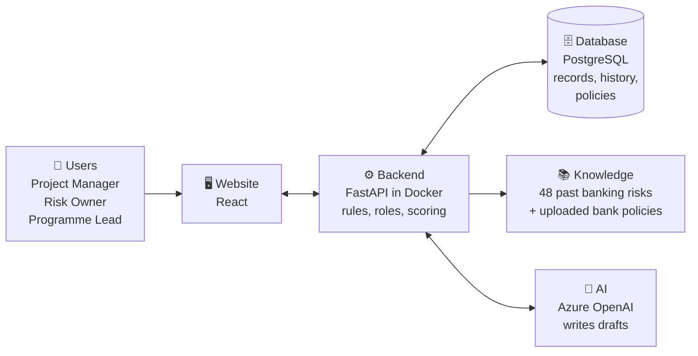
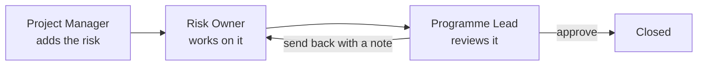

# Architecture

RiskPilot is a web application that helps bank project teams record, rank,
fix and approve project risks and issues in one place.

## The Big Picture

**In one sentence:** users work on the website, the website only talks to the
backend, and the backend does everything else: it applies the rules, saves the
data, finds relevant knowledge, and asks the AI for drafts.

## The Parts

| Part | Technology | What it does |
|------|------------|--------------|
| Website | React | What users see and click: dashboard, register, forms, review |
| Backend | Python FastAPI, in a Docker container | The brain: checks data, enforces roles and workflow, calculates scores, records history |
| Database | PostgreSQL | Stores records, their history, and uploaded policy text |
| AI | Azure OpenAI | Writes descriptions and mitigation plans, and finds risks in emails |
| Knowledge search | TF-IDF + FAISS | Finds similar past banking risks and relevant policy passages for the AI |

## Who Does What

| Role | Can do |
|------|--------|
| Project Manager | Add records (by hand or from emails with AI), upload policies, edit, review |
| Risk Owner | Work on records and submit them for review |
| Programme Lead | Approve and close, or send back with a note |

Record status: **Open -> In Progress -> Pending Review -> Closed**

## What Happens When...

**...a record is created**
1. The website sends the details to the backend.
2. The backend checks the data and the user's role.
3. It calculates the score: probability x impact (Low, Medium, High, Critical).
4. It saves the record in the database and writes a history entry.

**...someone clicks "Draft with AI"**
1. The backend searches for similar past banking risks.
2. It searches the uploaded bank policies for relevant rules.
3. It sends the description, banking rules, past risks and policy rules to Azure OpenAI.
4. The AI writes a clear description, a mitigation plan and follow-up actions.
5. The person reviews it and decides what to keep. Nothing is saved automatically.

**...someone uses "Import from text"**
1. The user pastes an email or meeting notes.
2. Azure OpenAI finds every risk and issue in the text.
3. The user reviews each draft and creates the ones that matter.

**...a policy PDF is uploaded**
1. The Project Manager uploads the PDF.
2. The backend reads the text and splits it into short passages.
3. The passages are saved in the database, ready for the AI to use.

## Safety Rules

- **Fair scoring:** a fixed formula decides priority, never the AI.
- **AI only suggests:** a person reviews every draft before saving.
- **Banking focus:** the AI follows banking rules, past banking risks and the bank's own policies, and must not invent regulations.
- **Approval before closing:** only the right role can close a record, after review.
- **Full history:** every change is recorded with who did it and when.
- **No shortcuts:** the website only talks to the backend, so the rules can't be bypassed.
- **Secrets stay safe:** keys and passwords are in settings, never in the code or on GitHub.

## Deployment Status (Day 34)

| Part | Status |
|------|--------|
| AI on Azure OpenAI | Done |
| Backend packaged in Docker | Done |
| Database on Azure PostgreSQL | In progress |
| Website and backend hosted on Azure | In progress |
| Automatic testing and deployment (CI/CD) | In progress |