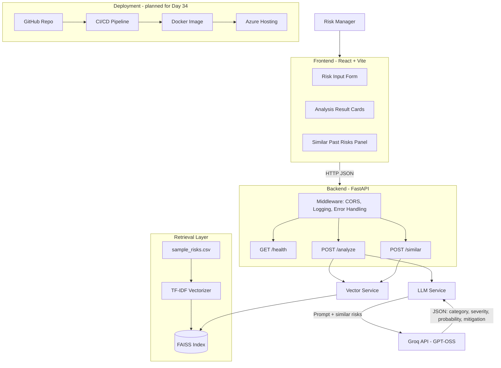

# Architecture

## System Overview

## Components

| Layer | Component | Responsibility |
|-------|-----------|----------------|
| Frontend | React + Vite | Input form, result cards, similar risks panel |
| Backend | FastAPI | REST API, validation, CORS, error handling |
| LLM Service | Groq API (GPT-OSS) | Classifies the risk and suggests mitigation |
| Vector Service | TF-IDF + FAISS | Finds similar past financial risks |
| Data | sample_risks.csv | Knowledge base of past risks and mitigations |
| DevOps | GitHub, Docker, Azure | Version control, containers, hosting |

## Request Flow (POST /analyze)
1. The user types a financial risk or issue in the React form.
2. React sends the text to the FastAPI backend as JSON.
3. The Vector Service converts the text to a TF-IDF vector.
4. FAISS returns the 3 most similar past risks.
5. The LLM Service sends the text and the similar risks to the Groq model.
6. The model returns the type, category, severity, probability and mitigation.
7. The backend returns the result with the similar risks.
8. React shows the result cards and the similar risks panel.

## API Endpoints

| Method | Path | Purpose |
|--------|------|---------|
| GET | /health | Check that the server is running |
| POST | /analyze | Classify, rate and suggest mitigation |
| POST | /similar | Return similar past risks only |