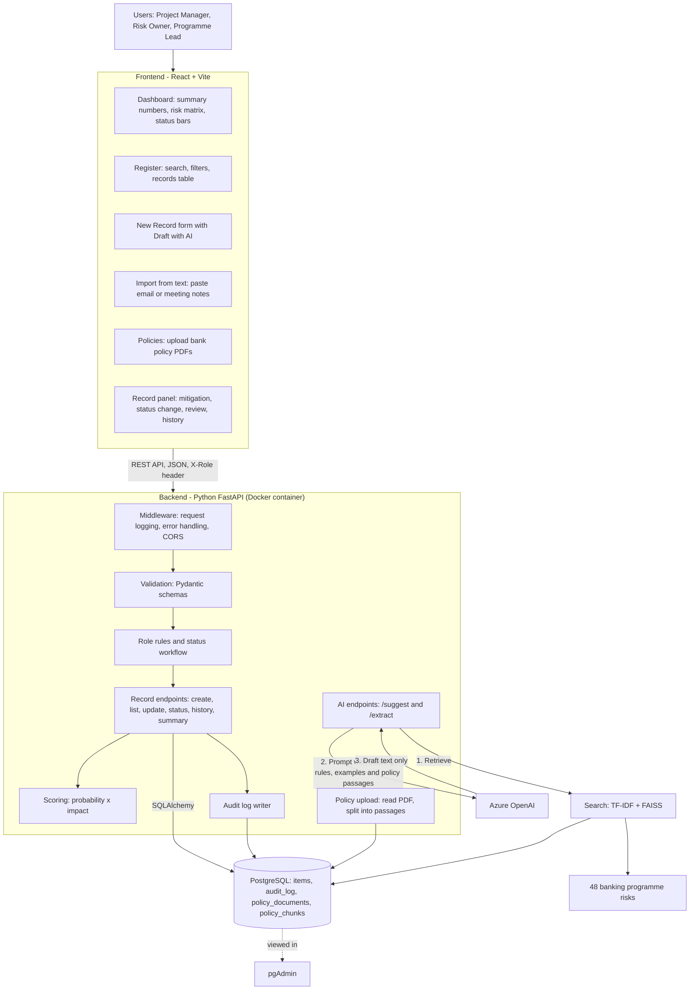
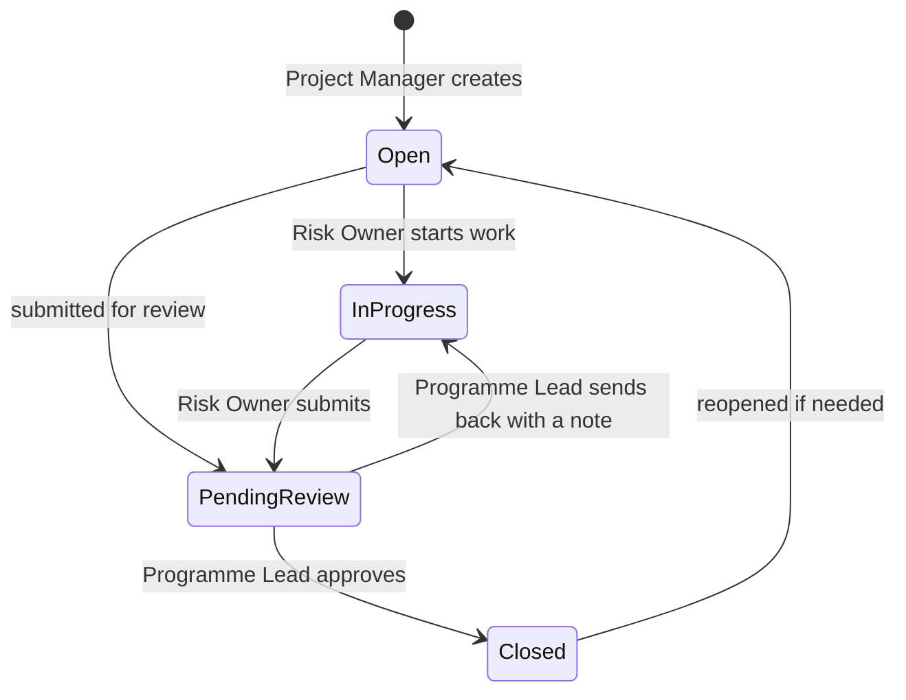

# Architecture

RiskPilot is a full-stack web application for managing project delivery risks
and issues in banking technology programmes.

## System Overview

## Layers

| Layer | Technology | Responsibility |
|-------|------------|----------------|
| Frontend | React (Vite) | Dashboard, register, forms, review panel, Import from text, Policies. Stores nothing permanently |
| Backend | Python, FastAPI, in a Docker container | Validation, roles, status workflow, scoring, audit log, AI calls, policy upload, middleware |
| Database | PostgreSQL with SQLAlchemy | Records, history and policy passages. Chosen through the DATABASE_URL setting |
| AI | Azure OpenAI | Drafts descriptions and mitigations, and extracts risks from text |
| Retrieval (RAG) | TF-IDF + FAISS | Finds similar past banking risks and relevant bank policy passages |

## Roles and Record Workflow

| Role | Can do |
|------|--------|
| Project Manager | Create records (by hand or from text with AI), upload policies, edit, change status, review |
| Risk Owner | Edit records, move to In Progress or Pending Review |
| Programme Lead | Review: approve and close, or send back with a note |

## Main Flows

- **Create a record:** The backend checks the data and the role, calculates
  score and priority, saves the record in PostgreSQL and writes a "created"
  entry in the audit log.
- **Draft with AI:** The backend finds similar past banking risks and relevant
  bank policy passages, adds them and the banking rules to the prompt, and
  Azure OpenAI drafts a description, category, mitigation and follow-up actions.
- **Import from text:** Azure OpenAI finds every risk and issue in pasted text
  and returns drafts. The user reviews each one before creating a record.
- **Upload a policy:** The Project Manager uploads a PDF. The backend reads the
  text, splits it into passages and stores them for retrieval.
- **Review:** The Risk Owner submits a record. The Programme Lead approves and
  closes it, or sends it back with a note. Every step is audited.

## Key Design Rules

- Scoring is deterministic: probability x impact, with fixed priority bands.
  The AI never decides it.
- The AI only drafts text. Nothing is saved until a person accepts it.
- The AI is grounded in banking: banking rules, past banking risks and the
  bank's own policies. It must not invent regulation details.
- A record can only be closed after review, by a user with the right role.
- Every create, update and status change is written to the audit log.
- The frontend only talks to the backend, so the rules cannot be bypassed.
- Secrets and settings come from environment variables, never from the code.

## Deployment (Day 34)

| Part | Status |
|------|--------|
| AI: Azure OpenAI | Done |
| Backend Docker image | Done |
| Azure Database for PostgreSQL | In progress |
| Backend and frontend hosted on Azure | In progress |
| CI/CD with GitHub Actions | In progress |