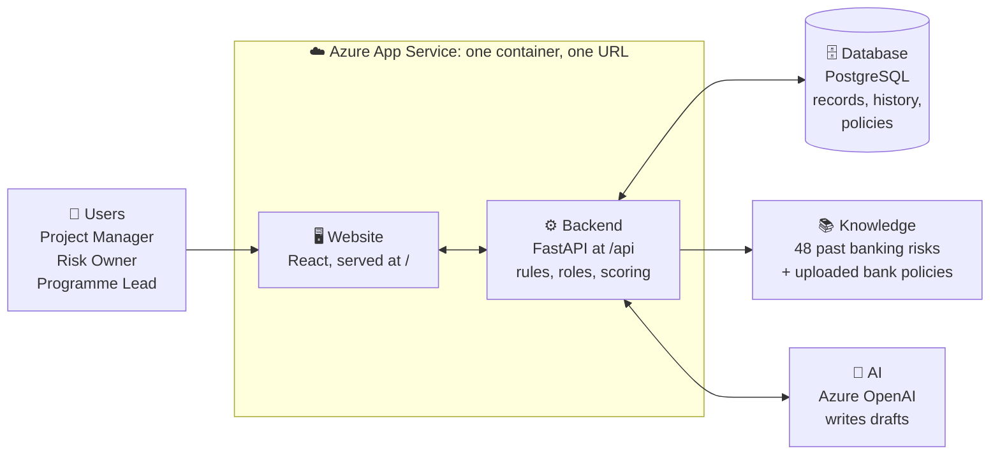
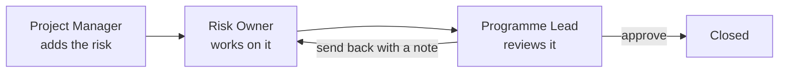
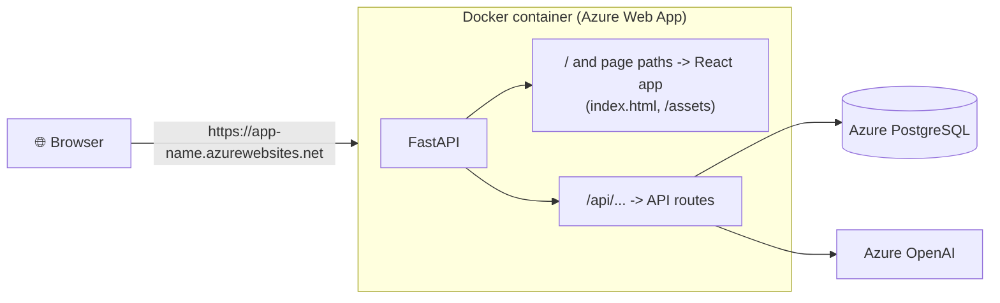

# Architecture

RiskPilot is a web application that helps bank project teams record, rank,
fix and approve project risks and issues in one place.

## The Big Picture

**In one sentence:** users work on the website, the website only talks to the
backend, and the backend does everything else: it applies the rules, saves the
data, finds relevant knowledge, and asks the AI for drafts. Website and backend
run in one container on one URL.

## The Parts

| Part | Technology | What it does |
|------|------------|--------------|
| Website | React (Vite build) | What users see and click: dashboard, register, forms, review. Built into the container and served by FastAPI |
| Backend | Python FastAPI | The brain: checks data, enforces roles and workflow, calculates scores, records history. API under `/api` |
| Hosting | One Docker container on Azure App Service | Website and API on one URL, so no cross-origin setup is needed |
| Database | PostgreSQL | Stores records, their history, and uploaded policy text |
| AI | Azure OpenAI | Writes descriptions and mitigation plans, and finds risks in emails |
| Knowledge search | TF-IDF + FAISS | Finds similar past banking risks and relevant policy passages for the AI |

## Who Does What

| Role | Can do |
|------|--------|
| Project Manager | Add records (by hand or from emails with AI), upload policies, edit, review |
| Risk Owner | Work on records and submit them for review |
| Programme Lead | Approve and close, or send back with a note |

Record status: **Open -> In Progress -> Pending Review -> Closed**

## What Happens When...

**...a record is created**
1. The website sends the details to the backend.
2. The backend checks the data and the user's role.
3. It calculates the score: probability x impact (Low, Medium, High, Critical).
4. It saves the record in the database and writes a history entry.

**...someone clicks "Draft with AI"**
1. The backend searches for similar past banking risks.
2. It searches the uploaded bank policies for relevant rules.
3. It sends the description, banking rules, past risks and policy rules to Azure OpenAI.
4. The AI writes a clear description, a mitigation plan and follow-up actions.
5. The person reviews it and decides what to keep. Nothing is saved automatically.

**...someone uses "Import from text"**
1. The user pastes an email or meeting notes.
2. Azure OpenAI finds every risk and issue in the text.
3. The user reviews each draft and creates the ones that matter.

**...a policy PDF is uploaded**
1. The Project Manager uploads the PDF.
2. The backend reads the text and splits it into short passages.
3. The passages are saved in the database, ready for the AI to use.

## Safety Rules

- **Fair scoring:** a fixed formula decides priority, never the AI.
- **AI only suggests:** a person reviews every draft before saving.
- **Banking focus:** the AI follows banking rules, past banking risks and the bank's own policies, and must not invent regulations.
- **Approval before closing:** only the right role can close a record, after review.
- **Full history:** every change is recorded with who did it and when.
- **No shortcuts:** the website only talks to the backend, so the rules can't be bypassed.
- **Secrets stay safe:** keys and passwords are in settings, never in the code or on GitHub.

## Deployment: One Container on Azure App Service

- **Build:** the Dockerfile has two stages. Stage 1 (`node:22-slim`) builds the React app.
  Stage 2 (`python:3.12-slim`) is the backend image (pinned packages, non-root `appuser`)
  with the built `frontend/dist` copied in.
- **Routing:** API routes are served under `/api` (and still at the root, for the
  load test, evaluation and existing tools). `/assets/...` and other real files are served
  from the build. Any other path returns `index.html`. Unknown `/api/...` paths stay JSON 404s.
- **Same origin:** the website calls `/api` on its own URL, so `VITE_API_URL` and CORS
  settings are not needed in production. `VITE_API_URL` still works as an override.
- **Local development:** the Vite dev server forwards `/api` to the backend on port 8000.
  If `frontend/dist` has not been built, the backend serves the API only.
- **Why not Static Web Apps:** it is blocked by the sandbox policy, so its deploy job in
  `cd.yml` is disabled (`if: false`).

## Deployment Status (Day 34)

| Part | Status |
|------|--------|
| AI on Azure OpenAI | Done |
| Website and backend packaged in one Docker container | Done (tested locally: website, API and AI features) |
| Database on Azure PostgreSQL | In progress |
| Hosted on Azure App Service (one URL) | In progress (pipeline ready, deploys when the Azure settings are added) |
| Automatic testing and deployment (CI/CD) | Done (GitHub Actions: tests, full-app Docker smoke test, image to GHCR, Azure Web App deploy) |

## Deployment Notes

- Run the App Service with **one instance**. The policy search index is kept in memory, so extra instances would not see newly uploaded policies until they restart.
- Tables are created on start-up (`create_all`). It adds new tables but does not change existing ones, so a column change needs a manual SQL change or a migration tool such as Alembic.
- Roles come from the `X-Role` header and are not authenticated. Put the app behind Azure sign-in or IP restrictions before sharing the URL.