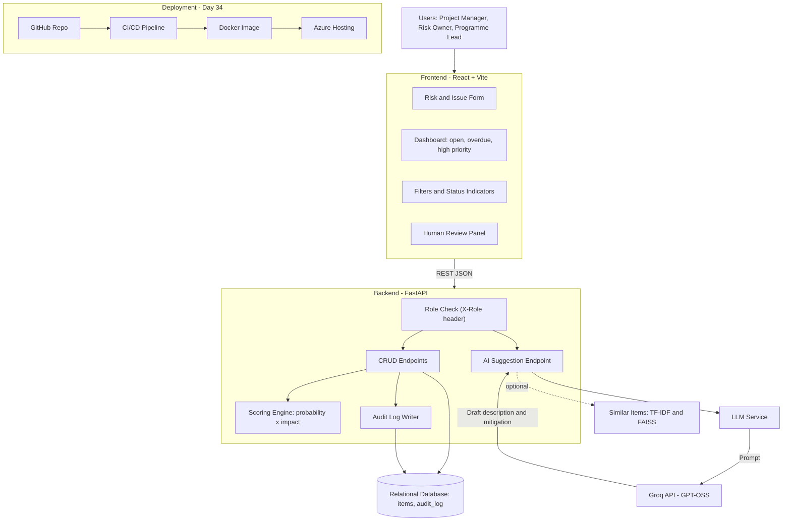

# Architecture

## Key Design Rules
- Scoring is deterministic: Probability x Impact, with fixed priority bands.
- The LLM only drafts text. Its output is a suggestion and a human must accept it.
- Status changes and approvals are made by users with the right role.
- Every change is written to the audit log.