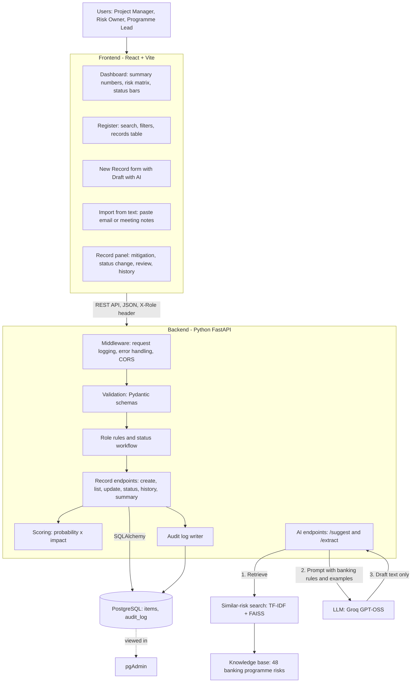
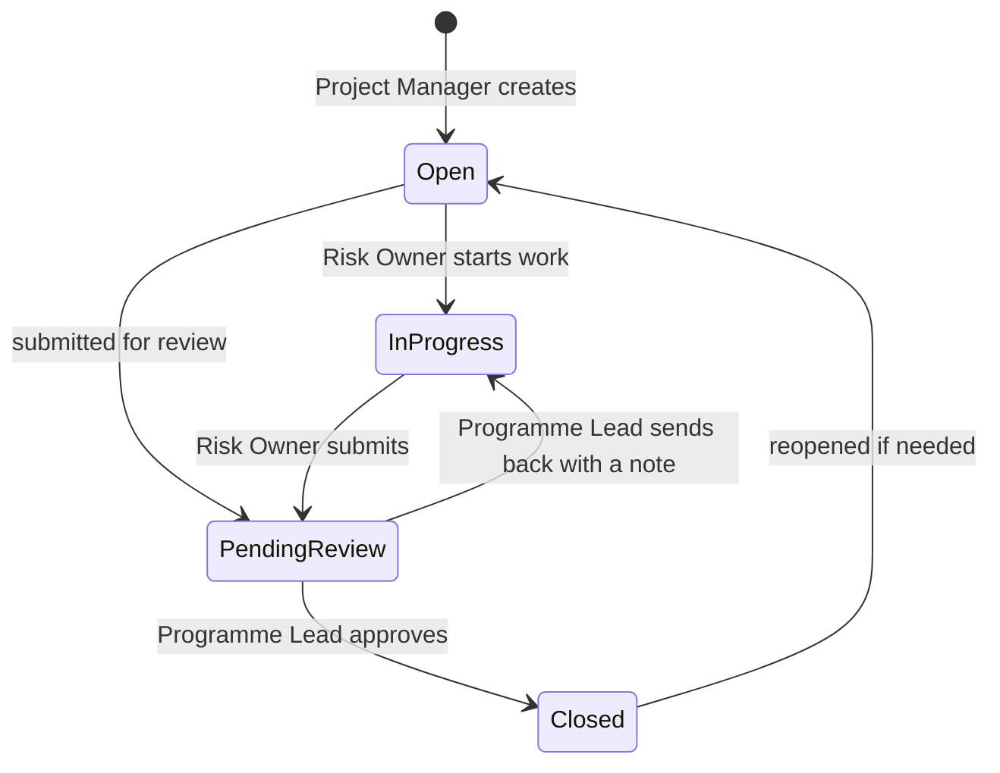

# Architecture

RiskPilot is a full-stack web application for managing project delivery risks
and issues in banking technology programmes.

## System Overview

## Layers

| Layer | Technology | Responsibility |
|-------|------------|----------------|
| Frontend | React (Vite) | Dashboard, register, forms, review panel, Import from text. Stores nothing permanently |
| Backend | Python, FastAPI | Validation, roles, status workflow, scoring, audit log, AI calls, middleware |
| Database | PostgreSQL with SQLAlchemy | Stores records (items) and history (audit_log). Chosen through the DATABASE_URL setting |
| AI | Groq LLM (GPT-OSS) | Drafts descriptions and mitigations, and extracts risks from text |
| Retrieval (RAG) | TF-IDF + FAISS | Finds the 3 most similar past banking risks to guide the AI |

## Roles and Record Workflow

| Role | Can do |
|------|--------|
| Project Manager | Create records (by hand or from text with AI), edit, change status, review |
| Risk Owner | Edit records, move to In Progress or Pending Review |
| Programme Lead | Review: approve and close, or send back with a note |

## Main Flows

- **Create a record:** Frontend sends the record to the backend. The backend
  checks the data and the role, calculates score and priority, saves the
  record in PostgreSQL and writes a "created" entry in the audit log.
- **Draft with AI:** The backend finds similar past banking risks (TF-IDF +
  FAISS), adds them and the banking rules to the prompt, and the LLM drafts a
  clearer description, category, mitigation and follow-up actions.
- **Import from text:** The user pastes an email or meeting notes. The LLM
  finds every risk and issue and returns drafts. The backend checks the drafts,
  and the user reviews each one before creating a record.
- **Review:** The Risk Owner submits a record for review. The Programme Lead
  approves and closes it, or sends it back with a note. Every step is written
  to the audit log.

## Key Design Rules

- Scoring is deterministic: probability x impact, with fixed priority bands
  (Low 1-5, Medium 6-12, High 13-19, Critical 20-25). The AI never decides it.
- The AI only drafts text. Its output is marked as a suggestion, and nothing is
  saved until a person accepts it.
- The AI is grounded in banking: banking rules in the prompt and a library of
  banking programme risks for retrieval. It must not invent regulation details.
- A record can only be closed after review, by a user with the right role.
- Every create, update and status change is written to the audit log.
- The frontend only talks to the backend, so the rules cannot be bypassed.
- Secrets and settings come from environment variables, never from the code.

## Planned (Day 34)

| Part | Now | On Azure |
|------|-----|----------|
| AI | Groq | Azure OpenAI |
| Database | Local PostgreSQL | Azure Database for PostgreSQL |
| Backend | Runs locally | Docker container on Azure |
| Frontend | Runs locally | Hosted on Azure |
| Delivery | Manual | CI/CD with GitHub Actions |