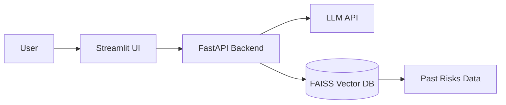

# Architecture

## Flow
1. User enters a risk or issue in the Streamlit UI.
2. The UI sends it to the FastAPI backend.
3. The backend searches FAISS for similar past risks.
4. The backend sends the text and similar risks to the LLM.
5. The LLM returns the classification, severity and mitigation.
6. The result is shown to the user.